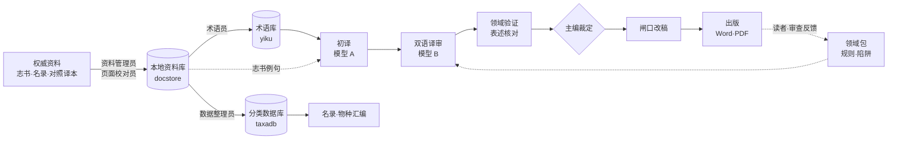

# Taxonomy-Aware Scientific Book Translation

面向分类学的专业书籍翻译系统：**术语有出处、原文可追溯、异模型审校、分类学专用验证、学目标语领域写法**。

它不只是一个翻译工具，而是一个专业知识底座加上几条生产线：同一份权威资料（志书、名录、名家译作）学习一次，同时产出

1. **译著**：专著的中文版（Word / PDF，插图、目录、参考文献、索引）；
2. **术语库**：每个术语、类群名的中文定名都带出处与依据等级；
3. **分类数据库**：资料中的物种记述、名称用法、异名、分布，结构化、可回原页。

核心与领域无关；专业知识放在「领域包」里。分类学（多毛类、星虫、螠虫、蛭类等）是第一个领域包，进化生物学、科学史已有雏形。


## 流程总览



各模块的专职 agent、详细流程图与协作规则见 [agents/README.md](agents/README.md)；通用化设计见 [docs/generic.md](docs/generic.md)。

## 文档

| 文件 | 内容 |
|---|---|
| [docs/design.md](docs/design.md) | 顶层设计：定位、原则、四层架构、数据与状态、模块、模型分配、质量体系、路线图 |
| [docs/workflow.md](docs/workflow.md) | 工作流细则：依据次序、学习新资料、每章翻译命令、质量门、出版、回流、软件设计 |
| [docs/architecture.md](docs/architecture.md) | **组件架构与接口**：docstore 本地资料库、termbase、taxadb、translate、qa、publish；重构顺序与验收 |
| [agents/README.md](agents/README.md) | **多智能体分工**：10 个角色（主编、资料管理员、页面校对员、术语员、数据整理员、译者、双语审校、领域验证员、表述编辑、出版员）、流程图、协作规则；`.claude/agents/` 为可直接调用的定义 |
| [docs/generic.md](docs/generic.md) | **通用专业翻译系统**：核心概念、十阶段流程、领域包插件接口、学习回路、软件形态 |
| [docs/comparison.md](docs/comparison.md) | 与开源翻译项目（translation-agent、translate-book、book-translator、claude-translation-skill、PDFMathTranslate/BabelDOC 等）和行业标准（ISO 17100/18587、MQM、CAT 工具）的对比 |
| [skill/](skill/) | 给模型用的技能（任何模型照着执行）：SKILL.md、RULES、PROMPTS、TERMS、STYLE、领域包 |

## 目录

```
docs/        设计与对比
skill/       模型技能（流程、规则、提示词、领域包）
yiku/        术语库模块（原独立仓库 yiku，含历史迁入）
scripts/     流水线脚本：术语查询、验证、闸口、批量翻译与核译、排版
yiku/tests/ 术语库测试
```

数据（原书、译文、OCR、术语数据库、分类数据库）不进仓库，路径由各工程目录配置。

## 状态

设计已定，部分模块可用（术语库、批量初译/核译、闸口、分类学验证、出版排版）；工程状态、陷阱回归、段对齐、裁定工作单、检索表校验按 [docs/design.md](docs/design.md) 路线图开发中。第一个实例：Rouse, Pleijel & Tilic (2022) *Annelida* 中译（学习交流用）。

## 许可与版权

代码与文档另行声明许可。本仓库不包含任何受版权保护的书籍原文或译文。
