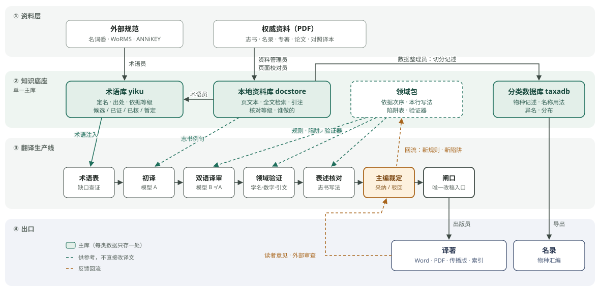
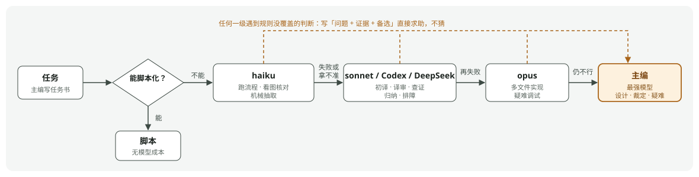

# 多智能体分工（Agents）

每个模块由一个专职 agent 负责。agent 之间只通过文件交接（资料库、术语库、问题单、状态表），由「主编」分派与裁定。Claude Code 可直接调用 `.claude/agents/` 下的定义；Codex、DeepSeek 等读本文件与仓库根 `AGENTS.md` 执行同样职责。

## 总流程图

绿色实线框是主库（每类数据只存一处）；绿色虚线是参考输入，不直接改译文；橙色虚线是反馈回流。

## 模型分派与升级

## 角色表

| agent | 负责模块 | 输入 → 输出 | 主要命令 | 默认模型 | 通过标准 |
|---|---|---|---|---|---|
| **主编** lead | 编排与裁定 | 全部问题单、冲突 → 裁定记录、规则更新、任务书 | `project status/next` | 最强模型（Fable / Opus） | 每条裁定有依据；规则变更进领域包 |
| **资料管理员** librarian | docstore | PDF → 登记、页文本、质量清单 | `store add/text/quality/status/detect/import` | 脚本 + haiku | 每页有文本或标空白；产物带 producer |
| **页面校对员** page-proofer | docstore 核对 | 低质量页、关键页 → 校正 | `store page --image`、`store verify` | haiku（看图） | 只按原页改，留痕；看不清标出不猜 |
| **术语员** terminologist | termbase | 原文章节 → 术语表、缺口、定名候选 | `terms table/gaps/lookup/import` | sonnet | 每个术语有出处等级；查不到标暂定 |
| **数据整理员** data-curator | taxadb（领域数据） | 志书页 → 物种记述、名称用法、名录 | `data extract/verify/export` | haiku + sonnet | 关键字段对原页核过；原样拼写 |
| **译者** translator | 初译 | 原文段 + 术语表 + 例句 → 译文段 | `run draft` | sonnet / Codex（模型 A） | 段段对应，无漏段 |
| **双语审校** reviser | 译审 | 原文 + 译文 → 问题单 | `run review` | 与译者不同的模型（模型 B） | 正反两遍、数字专名、结构计数 |
| **领域验证员** validator | 验证 | 原文 + 译文 → 报警 → 问题单 | `run validate` | 脚本 + haiku 分拣 | 报警全部处理或说明 |
| **表述编辑** style-editor | 本行写法 | 描述段、图注、释义 → 问题单（type 表述） | `run style` | sonnet | 合乎领域包 style 规范，附志书例句 |
| **出版员** publisher | 出版 | 译文 + 配置 → docx/PDF/传播版 | `publish build/float/toc/check` | haiku 跑，sonnet 排障 | 目录页码、图注、空白页、字体检查全过 |

## 协作规则

1. **分派**：主编写任务书（目标、输入输出路径、通过标准、禁止事项），能脚本化的不用模型，按最小够用的模型派。
2. **升级**：agent 失败一次或自报拿不准 → 升一级模型；两级都失败 → 主编。
3. **求助**：遇到任务书没覆盖的判断（译名取舍、规则冲突、数据与原页不符），写「问题 + 证据 + 备选」交主编，不猜。
4. **隔离**：只写自己负责的主库；改译文只能经闸口；不得另建库；写入带 `--by <模型名>`。
5. **不再派生**：agent 不得再开子 agent；每完成一步写盘。
