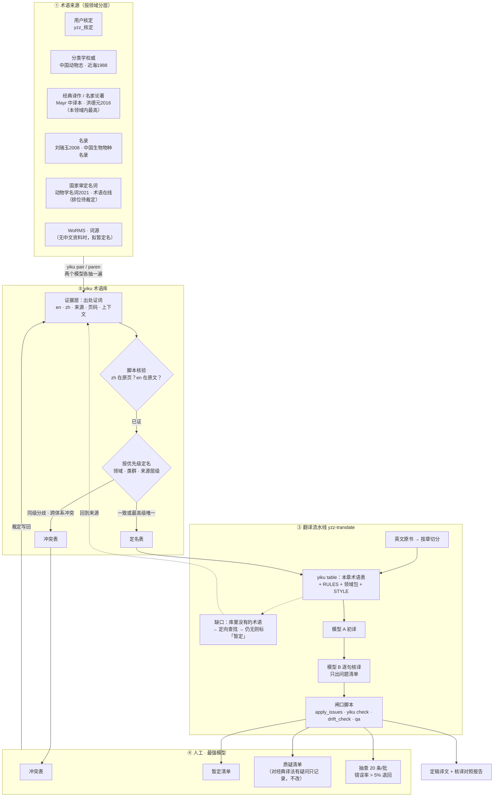

# 英译中专业翻译：整体思路与框架

2026-11-09。yiku 是这套框架中的术语层。翻译流水线本身在技能 `yzz-translate` 中（本仓库之外）。

## 核心思路

1. **难在术语，不在句子。** 普通句子任何大模型都能译好。分类学和进化生物学的术语有规范译名，模型凭网络语料常常译错，几个模型轮换使用时还会各译各的。
2. **术语来自权威，不来自模型。** 每个译名都要有出处：书名和页码。经典译作和名家论著经过考证，在其本领域内直接采用。
3. **模型只做体力活，证据和规则负责定名。** 抽取、初译、核译交给任何模型，token 不限。核验交给脚本。只有冲突和抽查交给人。
4. **准确性必须可测量。** 每批随机抽查 20 条，错误率超过 5% 就退回重做。

## 总体框架

## 分工

| 角色 | 做什么 | 用谁 |
|---|---|---|
| 执行者 | 抽取、初译、核译、查找缺口 | 任何模型：Codex、DeepSeek、Claude 子代理，token 不限 |
| 闸口 | 核验出处、精确替换、检查一致性 | 脚本，不用模型 |
| 裁定者 | 处理冲突、暂定和质疑三份清单，做抽查 | 用户，或最强模型 |

初译和核译必须交给不同的模型，这样一个模型的盲点能被另一个模型发现。

## 来源规则

- **领域隔离**：同一英文词在不同领域可以有不同的定名。例如 population 在物种概念领域译「居群」（洪德元2016 p.980），在生态学中译「种群」。
- **经典译作**：在其本领域内是最高依据，照用。翻译时如果怀疑某个译法有误，不改译，只记入质疑清单，由用户裁定。
- **没有中文资料的分类阶元**：先查 WoRMS（有效名、上级类群、原始描述中的 Etymology）。能从上级或下级已有的中文名派生的，就派生；不能派生的，按拉丁或希腊词源意译。拟出的名称一律写成「暂定名（*Latin*）」，并写明依据。
- **模型自拟的译名**：只能标「暂定」，不得作为定名入库。

## 实现状态

| 部件 | 状态 |
|---|---|
| `yiku source / import / paren / pair / table / check / lookup / review / wikidata / stats` | 已实现 |
| `yzz-translate` 流水线：切章、初译、核译、闸口脚本、领域包 | 已实现 |
| `yiku verify`：脚本核验出处，候选 → 已证 | 计划中 |
| `yiku resolve`：按规则定名，输出定名表和冲突表 | 计划中 |
| `yiku gaps`：列出本章缺口术语 | 计划中 |
| 来源层级按领域生效（经典译作在本领域内为最高） | 计划中 |
| `run_batches --engine deepseek`、双模型抽取、抽查统计 | 计划中 |
| 接入国家审定名词、《中国生物物种名录》2026 版 | 待用户裁定排位、待获取数据 |
